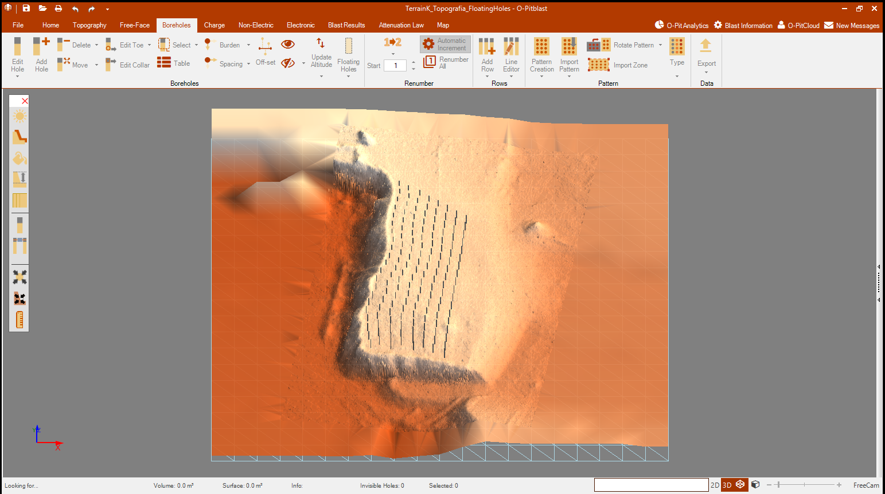
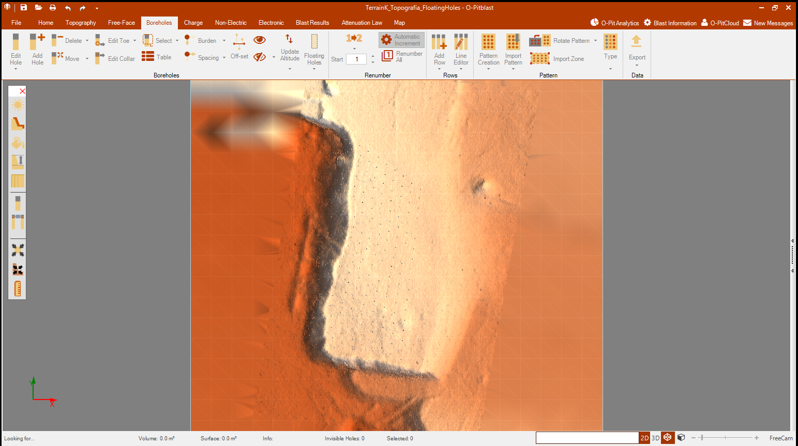
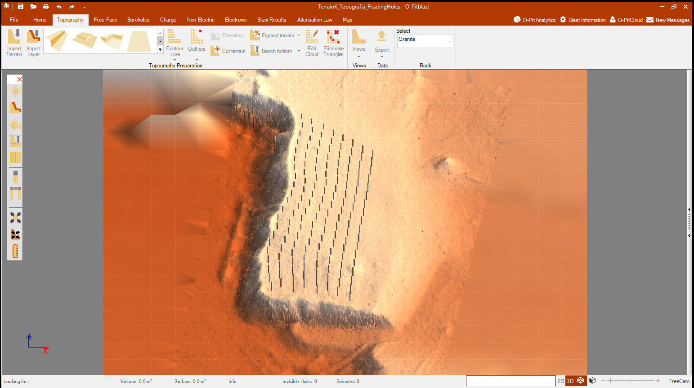

# O-PitBlast | Topografía y taladros

Primer flujo de trabajo con **O-PitBlast 1.5.93.0**: revisar datos de entrada, incorporar una topografía e importar coordenadas de taladros conservando la geometría de origen.

Este proyecto documenta una práctica inicial de manejo del software. El alcance es la importación y comprobación geométrica; no incluye diseño de cargas, tiempos de iniciación ni validación de un plan operativo de voladura.

## Alcance de esta primera etapa

- Identificar la versión correcta del programa y conectarla al control local de Windows.
- Revisar estructura, separadores, coordenadas, filas y campos de los archivos.
- Distinguir los datos compatibles de ejemplos que pertenecen a otra ubicación.
- Mapear coordenadas de boca y fondo sin intercambiar ejes ni ajustar cotas automáticamente.
- Conservar una copia del proyecto antes de modificar la sesión.
- Documentar el resultado con capturas de la interfaz.

## Datos de la práctica

| Conjunto | Contenido comprobado | Tratamiento |
| --- | --- | --- |
| Terrain K - Cloud 2 | Nube DXF con 114 548 puntos en la capa `CLOUD_001`; 114 259 posiciones XYZ únicas. | Topografía del conjunto principal. |
| Floating Holes | 153 registros con coordenadas XYZ de boca y fondo. | Coincide espacialmente con Terrain K. |
| Malla Ejemplo | 195 registros con ID y coordenadas de boca. | Conjunto distinto; mantener separado. No trae longitud ni coordenadas de fondo. |

Los originales no se distribuyen en este repositorio. El DXF no declara unidades ni sistema de referencia; se conserva su escala numérica y no se aplica una transformación de coordenadas.

## Evidencias y estado

La exportación nativa del terreno conserva **114 548 puntos** —114 259 posiciones únicas y 289 repeticiones— y **228 438 triángulos válidos**. Las coordenadas coinciden con el origen a tres decimales; el error máximo es **3.7841796875e-6**, inferior a la tolerancia de **0.0005**. Esto acredita la recuperación del relieve sin afirmar igualdad decimal exacta del terreno.

Los datos de `Floating Holes.csv`, con **153 registros de origen**, se incorporaron mediante `Boreholes → Floating Holes → Import`. La distribución final se observa sobre el banco y conserva el relieve. Esta capa se ha comprobado visualmente; aún no se dispone de un recuento o una exportación nativa final de esa capa.

Una prueba anterior con `Import Pattern` sí produjo una exportación de 153/153 registros con las seis coordenadas idénticas y longitudes geométricas de 13.774–14.305. Ese cotejo se documenta como una prueba previa, sin atribuirlo al estado final de Floating Holes.

El proyecto nativo `TerrainK_Topografia_FloatingHoles.opit` quedó guardado y se volvió a abrir en O-PitBlast con el relieve y la capa de taladros flotantes visibles. El archivo nativo se conserva localmente.

Las siguientes capturas muestran la sesión real del programa:

**Vista general del relieve y los taladros flotantes**

**Vista en planta**. Las coordenadas de los taladros se muestran como puntos sobre la superficie.

**Detalle del banco y la distribución de taladros**

## Documentación

- [Flujo inicial en el programa](docs/flujo-inicial.md)
- [Comprobación y mapeo de datos](docs/verificacion-datos.md)
- [Resultados numéricos de las comprobaciones](docs/resultados-fuentes.json)
- [Verificador reproducible de geometría](scripts/verificar_geometria.py)

## Herramientas utilizadas

- O-PitBlast **1.5.93.0**, en Windows.
- Codex y la skill local específica del programa.
- [Windows-MCP](https://github.com/CursorTouch/Windows-MCP), como puente general de interfaz de Windows. No es una API interna de O-PitBlast.
- Python y ezdxf para inspección de archivos y preparación de una copia XYZ cuando el importador lo requiera.

## Próximas etapas

Revisar propiedades de los taladros con datos de origen suficientes, obtener un recuento y una exportación verificable de la capa Floating Holes y ampliar el registro de comprobaciones. Cada etapa se incorporará con evidencia propia.
