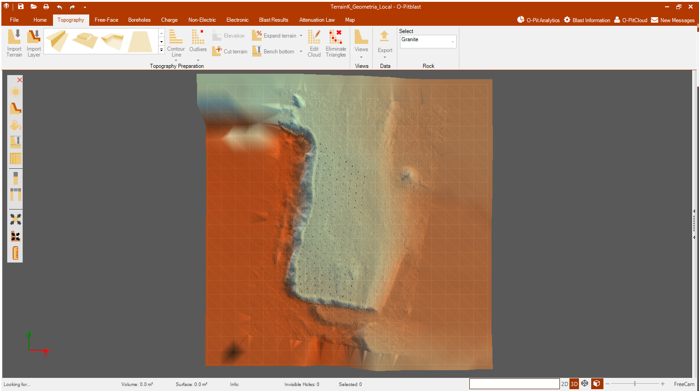
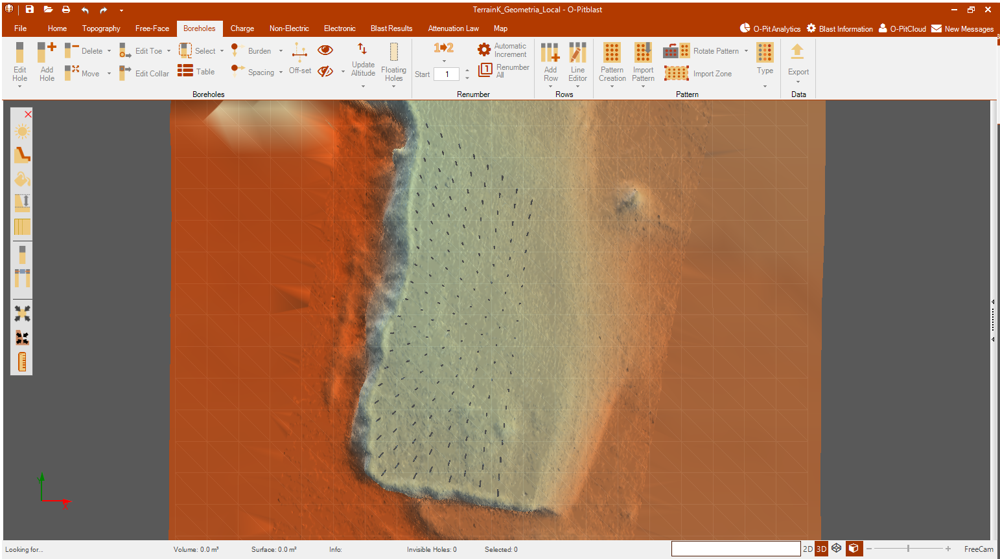

# Terrain K · Topografía y control geométrico en O-PitBlast

**Caso de estudio académico y técnico · O-PitBlast 1.5.93.0 · Python · Calidad de datos**

Integración de una nube topográfica y coordenadas de taladros, con trazabilidad desde los archivos de origen hasta las evidencias del programa. El proyecto combina manejo de software minero con comprobaciones reproducibles de geometría.

## Problema y resultado

El taller reúne archivos que parecen relacionados, pero **no todos corresponden a la misma ubicación**. Además, una importación de taladros puede sustituir el relieve por una superficie de collares. El trabajo consiste en conservar coordenadas y procedencia, incorporar el conjunto compatible y comprobar el resultado.

Se recuperó el relieve de Terrain K y se incorporó la capa `Floating Holes`. Una comprobación posterior del archivo guardado detectó pérdida de precisión en las coordenadas de la primera importación. Se preparó una referencia local reversible y se guardó y volvió a abrir `TerrainK_Geometria_Local.opit` con la geometría visible. Su lectura estructural confirma 114 548 puntos y 153 referencias distintas, y las 153 filas concuerdan con el modelo de precisión simple aplicado a las coordenadas locales. Una nueva exportación del terreno pasó el cotejo de puntos y los controles básicos de sus caras.

| Resultado medido | Valor |
| --- | ---: |
| Puntos topográficos conservados | 114 548 |
| Posiciones XYZ únicas / repeticiones | 114 259 / 289 |
| Triángulos revisados del modelo local final | 228 439 |
| Error máximo del cotejo CSV local del terreno | 0.0000062866210937 |
| Tolerancia de ese CSV de tres decimales | 0.0005 |
| Referencias Floating Holes leídas en el archivo final | 153 / 153 distintas |
| Máxima diferencia XY reconstruida de Floating Holes en referencia local | 0.0000037841796938 |
| Puntos de Malla Ejemplo mantenidos aparte | 195 |

Las cifras son controles de archivos y representaciones numéricas; no representan precisión de un levantamiento en campo. Las diferencias se expresan en las unidades numéricas de origen, sin atribuirles metros certificados. Las fuentes no declaran unidades ni sistema de referencia. La lectura estructural del nativo es independiente de una exportación del programa y no constituye una API oficial.

La primera exportación tenía 228 438 caras; el modelo local final tiene una más. Ambos cotejos se documentan por separado: conservar los puntos a la precisión comprobada no implica conservar exactamente la misma triangulación.

## Dos vistas del resultado

**Vista general del modelo local y la distribución de referencias**



**Detalle de la distribución de Floating Holes sobre el banco**



Capturas reales de O-PitBlast. Los segmentos oscuros corresponden a una capa de referencia geométrica; no acreditan un diseño nuevo de perforación.

## Desarrollo técnico

1. Identificación de la versión y respaldo del proyecto nativo.
2. Inspección de campos, separadores, coordenadas, duplicados y hashes.
3. Extracción DXF → CSV XYZ conservando cadenas decimales, orden y repeticiones.
4. Importación del relieve y cotejo de su exportación nativa.
5. Importación específica de `Floating Holes`, con seis coordenadas de boca y fondo.
6. Guardado, reapertura y documentación de las comprobaciones y sus límites.
7. Lectura estructural de la geometría guardada, diagnóstico de precisión y preparación de una referencia local reversible.

Se detectaron y separaron los 195 registros de `Malla Ejemplo`, cuyas coordenadas pertenecen a otro conjunto. No se desplazaron para hacerlos coincidir.

## Explorar el proyecto

| Documento | Contenido |
| --- | --- |
| [Memoria técnica](docs/memoria-tecnica.md) | Problema, decisiones, resultados, criterios de aceptación y límites. |
| [Flujo en O-PitBlast](docs/flujo-inicial.md) | Pasos de la sesión, mapeo e importadores. |
| [Comprobación de datos](docs/verificacion-datos.md) | Evidencia numérica y distinción entre etapas. |
| [Precisión y referencia local](docs/precision-coordenadas.md) | Recuento estructural, representación Single, origen explícito y diferencias medidas. |
| [Reproducir las verificaciones](docs/uso-reproducible.md) | Comandos, requisitos, códigos de salida y pruebas. |
| [Resultados estructurados](docs/resultados-fuentes.json) | Recuentos, hashes, tolerancias y estado del proyecto. |
| [Auditoría de la referencia local](docs/referencia-local.json) | Comparación del archivo inicial y el local, origen exacto y exportación final. |
| [Descripción para CV y entrevista](docs/cv-y-entrevista.md) | Presentación breve del trabajo y competencias demostradas. |

## Ejecutar las pruebas

Requiere **Python 3.10 o posterior** y su biblioteca estándar. No instala dependencias.

```sh
python -m unittest discover -s tests -v
```

Las pruebas usan archivos sintéticos temporales. Los originales del taller y el proyecto `.opit` se conservan localmente; el repositorio publica documentación, código y dos capturas.

## Alcance

Este caso cubre topografía, importación y calidad geométrica. Quedan documentadas la ausencia de CRS y unidades certificadas, la falta de propiedades técnicas completas de los taladros y los límites del cotejo estructural. No constituye un plan operativo de voladura.

**Herramientas:** O-PitBlast 1.5.93.0, Python, inspección auxiliar con ezdxf y asistencia de Codex mediante la skill local y [Windows-MCP](https://github.com/CursorTouch/Windows-MCP). El control de interfaz es general de Windows; no es una API interna del fabricante. Proyecto personal sin afiliación al fabricante ni a una empresa minera.
